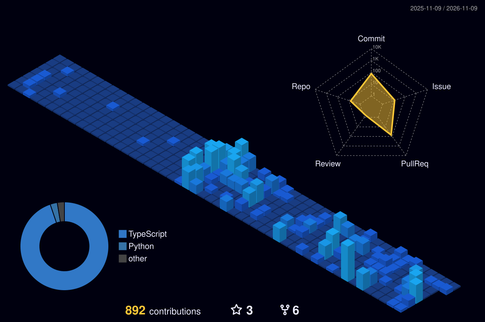

<!-- Self-hosted static SVG. capsule-render emits paths with an empty "d" that only exist inside SMIL, so the background vanished when animation did not run. -->

  

---

### About

- I **contribute to AI-DLC** (AI-Driven Development Lifecycle) — adaptive workflow steering rules for AI coding agents, provider bridges and run dashboards.
- Day job is **platform and backend engineering in banking**: FastAPI services, Keycloak auth, Airflow pipelines, Postgres and containerised deployments.
- Earlier work was **computer vision** — Vietnamese OCR, ID-card recognition and real-time face recognition pipelines.
- Based in **Hanoi, Vietnam** 🇻🇳 · 70+ public repositories.

---

### Stack

 

 

---

### Selected work

| Project | What it is |
| --- | --- |
| **[pi-kiro-connect](https://github.com/vnlebaoduy/pi-kiro-connect)** | Kiro (AWS CodeWhisperer/Q) provider for `pi` and Oh My Pi — kiro-cli-compatible login, live model catalog, credit usage. |
| **[KiroCrew](https://github.com/vnlebaoduy/KiroCrew)** | A persistent workspace for development work that self-improves and continues beyond one session. |
| **[aidlc-workflows](https://github.com/vnlebaoduy/aidlc-workflows)** | AI-Driven Life Cycle adaptive workflow steering rules for AI coding agents. |
| **[aidlc-dashboard-v2](https://github.com/vnlebaoduy/aidlc-dashboard-v2)** | Read-only web dashboard for an AI-DLC run: status, progress, blockers, timing and usage. |
| **[fastapi-keycloak-boilerplate](https://github.com/vnlebaoduy/fastapi-keycloak-boilerplate)** | FastAPI boilerplate with user management and authentication via Keycloak. |
| **[airflow-minio-postgres-fastapi](https://github.com/vnlebaoduy/airflow-minio-postgres-fastapi)** | Data-store stack with GitHub Actions CI/CD doing SSH deploy to remote Docker Compose. |

---

### GitHub activity

<!-- Generated in-repo daily by .github/workflows/profile-3d.yml - not dependent on any third-party uptime -->

 

---

Open to collaboration on agent tooling and AI-assisted engineering workflows — <a href="mailto:lebaoduy1993@gmail.com">say hello</a>.

